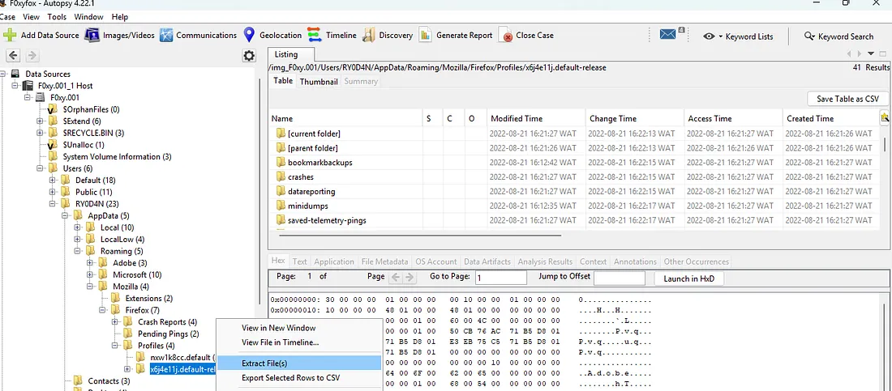
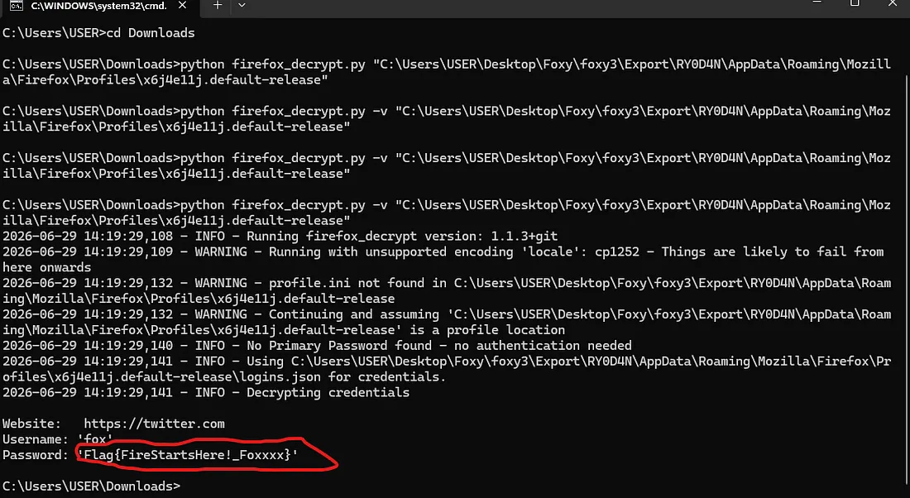
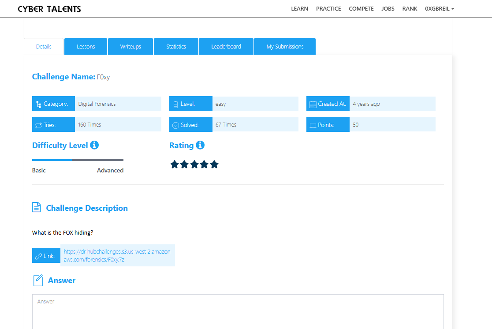
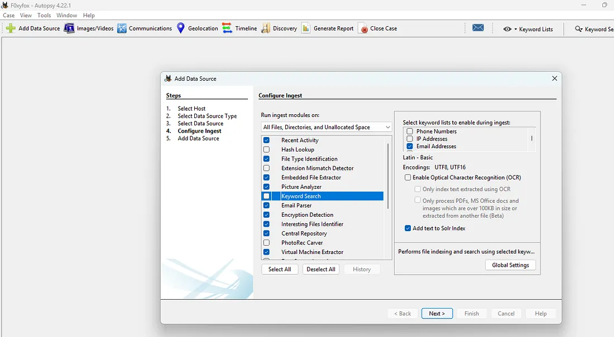

# Cyber Talents CTF Walkthrough: F0xy

## Challenge Description

Here before us is an easy-level room from the Cyber Talents platform titled “F0xy.” It’s supposed to be easy, but in truth it took me a lot of mental racking to be able to solve it.

I said this in the last post, and I’d say it again.

When you encounter a challenge, any challenge at all, and you don’t know the answer, you’ve solved 20 per cent once you can accurately tell what the challenge is testing or demanding of you. In my own case, I was presented with the image of a drive, but I didn’t know what the challenge was trying to test, so it took me a while before I finally solved it. Today I’m going to be walking you through solving this challenge. Let’s gooooooooo.

The challenge we have before us contains a dataset, a compressed image of a user’s hard disk. And the challenge is trying to test our knowledge of Browser Forensics, or more specifically, Mozilla Firefox forensics. If you think this clue gives you an idea and you want to try to solve the challenge one last time, feel free to pause and try again. If not, let’s do it together.

## Solution

### Step 1: Download the Dataset

Download the challenge dataset. It should be provided as a compressed 7-Zip archive.

### Step 2: Extract the Dataset

Extract `F0xy.7z` to access the disk image files.

### Step 3: Create a Case in Autopsy

Open Autopsy and create a new case.

Enter the required information, such as the case name and examiner's details. When selecting the data source type, choose **Disk Image or VM File**.

### Step 4: Configure Ingest Modules

Select the required ingest modules. There is no need to enable every module, as some are unnecessary and may significantly increase the processing time.

Enable the relevant modules and proceed with the ingestion process.



### Step 5: Examine the Disk Image

Once ingestion is complete, start examining the results in Autopsy.



Navigate to **Data Artifacts → Web History**.

You will notice that the user visited Twitter and accessed its login page. This indicates that the Firefox profile may contain useful login information.



### Step 6: Locate the Firefox Profile

Navigate to the Firefox profile directory shown in the source file path:

`Users/<Username>/AppData/Roaming/Mozilla/Firefox/Profiles/`

Locate the profile associated with the user.



### Step 7: Extract the Firefox Profile

Extract the entire Firefox profile folder from the disk image.

For better organization, create a folder named `recovered` inside your F0xy case directory and save the extracted profile there.

The extracted profile contains several Firefox artifacts, including browsing history, bookmarks, cookies, and saved login information.

### Understanding Firefox Login Artifacts

Since the user accessed Twitter, we need to examine the Firefox login artifacts:

#### 1. `logins.json`

This file stores saved login information for websites.

It contains information such as:

- Website URL
- Username (encrypted)
- Password (encrypted)
- Login creation time
- Last-used time
- Number of times the login was used

#### 2. `key4.db`

This database stores the cryptographic material Firefox uses to decrypt the information stored in `logins.json`.

It contains information such as:

- Master encryption keys
- NSS (Network Security Services) key information
- Password-based encryption information
- Salt values
- Key derivation data

### Step 8: Decrypt the Saved Credentials

Since the username and password in `logins.json` are encrypted, we need to decrypt them using an available tool.

For this task, we will use **firefox_decrypt.py**, an open-source tool available on GitHub:

https://github.com/unode/firefox_decrypt/

Download the tool and make sure Python is installed and added to your system PATH.

Open Command Prompt or PowerShell, navigate to the directory containing the tool, and run the following command:

```bash
python firefox_decrypt.py -v "PATH_TO_FIREFOX_PROFILE"
````

Replace `PATH_TO_FIREFOX_PROFILE` with the path to the extracted Firefox profile.

The tool successfully decrypts the saved credentials and reveals the Twitter login information.

## **Flag**

```
Flag{FireStartsHere!_Foxxxx}
```

```
