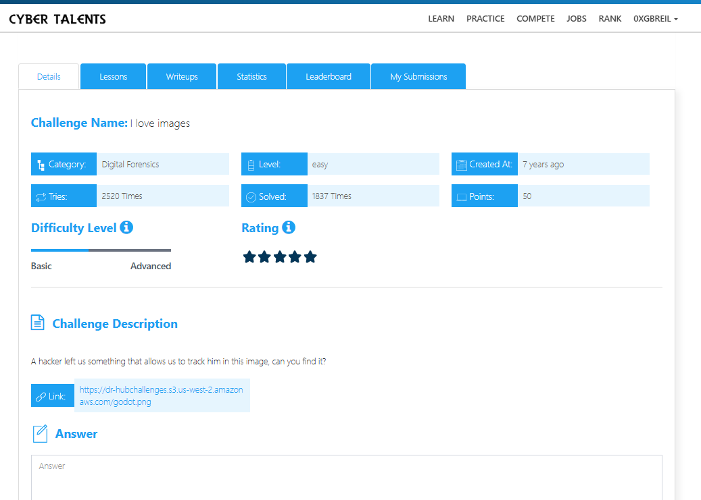
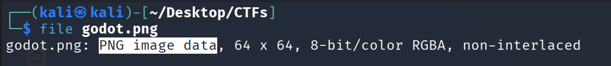
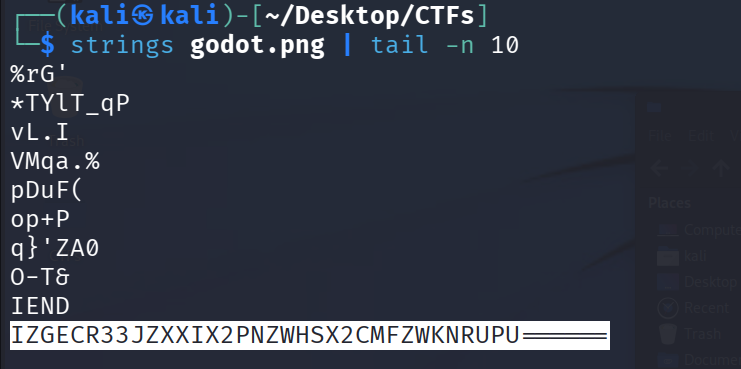
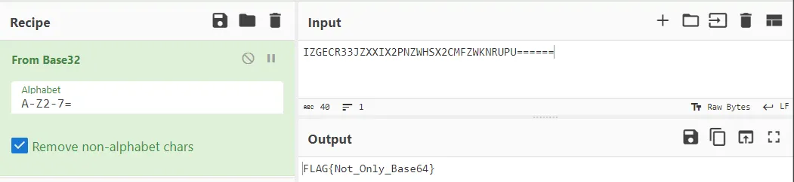

# I Love Images — CyberTalents Writeup

## Challenge Description

A hacker left us something that allows us to track him in this image. Can you find it?

**Challenge:** I love images  
**Category:** Digital Forensics  
**Difficulty:** Easy

## Solution

First, we download the image using `wget`:

```bash
wget https://dr-hubchallenges.s3.us-west-2.amazonaws.com/godot.png
```



Before analyzing the image, we can use the `file` command to identify its type:

```bash
file godot.png
```

The output confirms that it is a PNG image.



I tried extracting metadata using `exif` and `exiftool`, but I didn't find anything useful. So, I moved on to using `strings` to search for readable text inside the image:

```bash
strings godot.png | tail -n 10
```

This revealed an interesting string at the end of the file:



The string looks encoded, so I tried decoding it using Base64, but it didn't produce the expected result. After trying Base32 instead, I got the flag successfully.



The decoded flag is:

`FLAG{Not_Only_Base64}`
.
