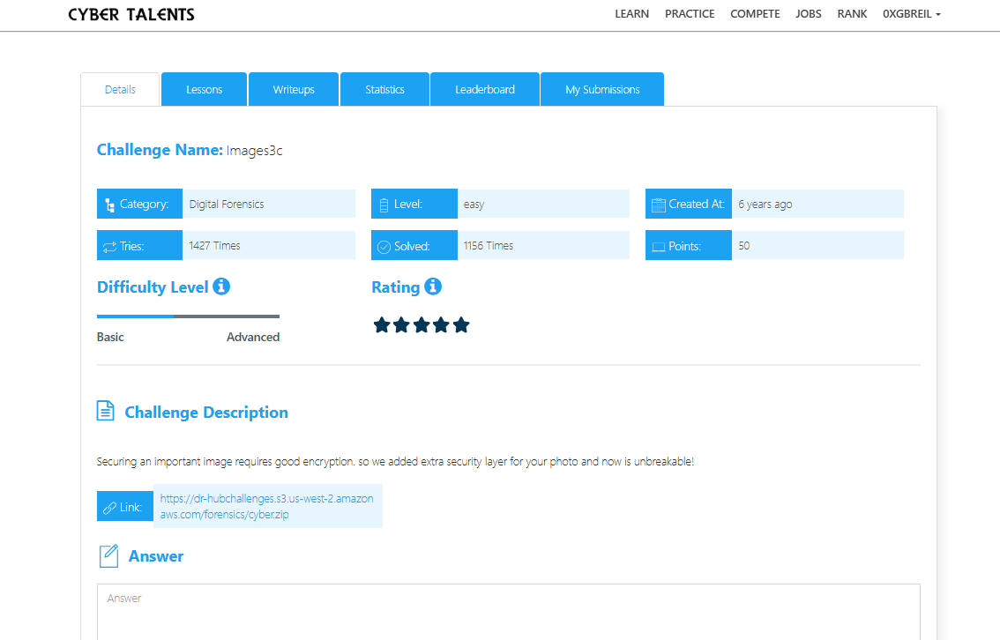
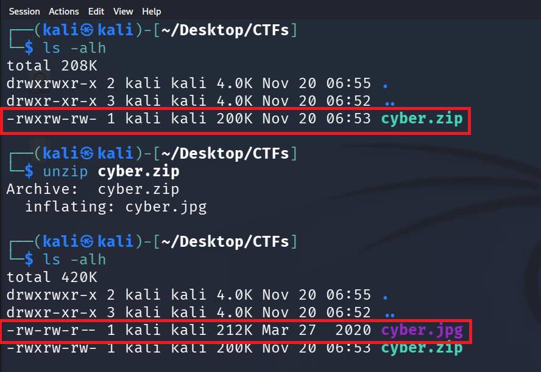
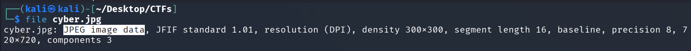
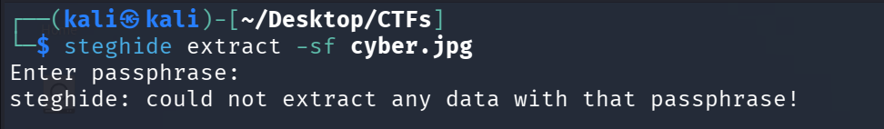
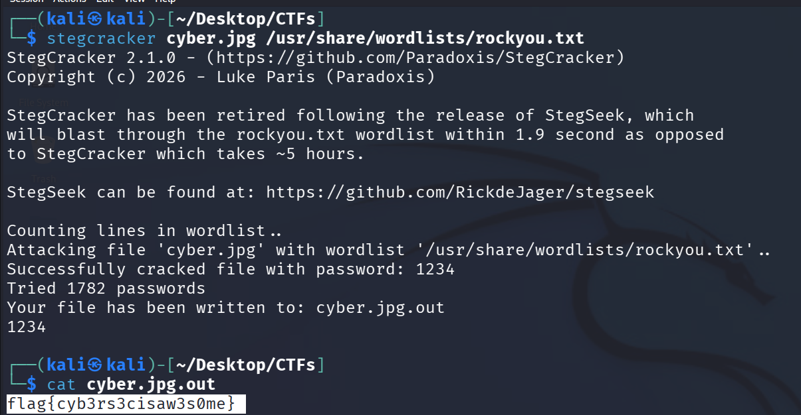

# Images3c - Digital Forensics Writeup

## Challenge Description
Securing an important image requires good encryption. so we added extra security layer for your photo and now is unbreakable!



---

## Extracting the File

After downloading the challenge, we find a ZIP archive named `cyber.zip`. We extract its contents using:

```bash
unzip cyber.zip
````

The archive contains an image named `cyber.jpg`.



## **File Identification**

Before analyzing the image, I checked its file type using the `file` command:

```
file cyber.jpg
```

The output confirms that it is a JPEG image.



## **Extracting Hidden Data**

I tried using `steghide` to extract any hidden data from the image:

```
steghide extract -sf cyber.jpg
```

However, the extraction failed because the image is protected with a passphrase.



## **Cracking the Passphrase**

To recover the passphrase, I used **StegCracker** with the `rockyou.txt` wordlist:

```
stegcracker cyber.jpg /usr/share/wordlists/rockyou.txt
```

The passphrase was successfully recovered:

```
1234
```

StegCracker also extracted the hidden data into `cyber.jpg.out`.



## **Extracting the Flag**

Finally, I read the extracted file using:

```
cat cyber.jpg.out
```

The flag was revealed:

```
flag{cyb3rs3cisaw3s0me}
```


