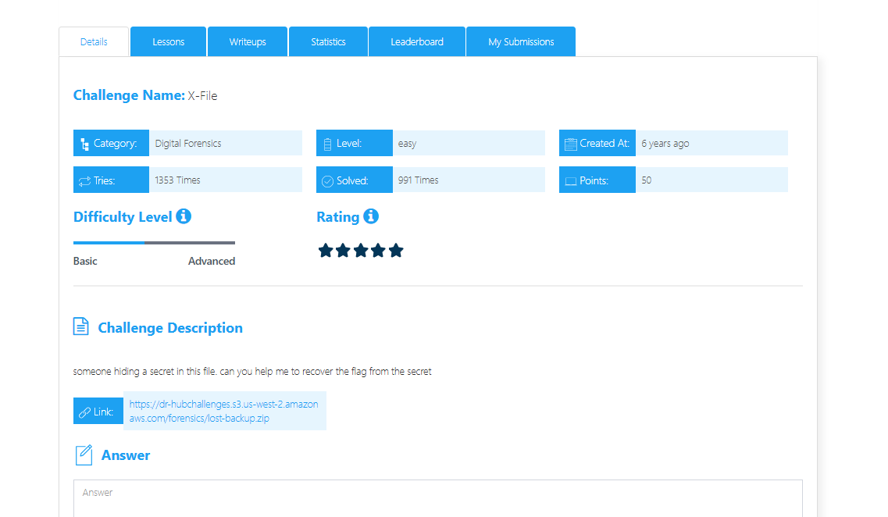
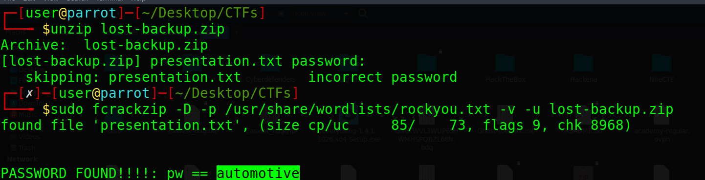
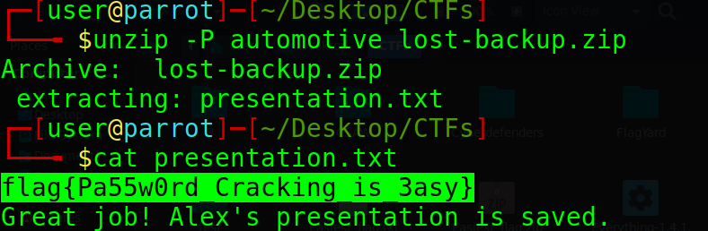

# X-File - Digital Forensics Writeup

## Challenge Description
someone hiding a secret in this file, can you help me to recover the flag from the secret



---

## Cracking the ZIP Password

The challenge file is a password-protected ZIP archive. I used `fcrackzip` with the `rockyou.txt` wordlist to crack the password:

```bash
sudo fcrackzip -D -p /usr/share/wordlists/rockyou.txt -v -u lost-backup.zip
```

The password was successfully recovered:

```text
automotive
```



---

## Extracting the Archive

After obtaining the password, I extracted the ZIP file using:

```bash
unzip -P automotive lost-backup.zip
```

This revealed a file named `presentation.txt` containing the flag.



---

## Final Flag

```text
flag{Pa55w0rd_Cracking_is_3asy}
```