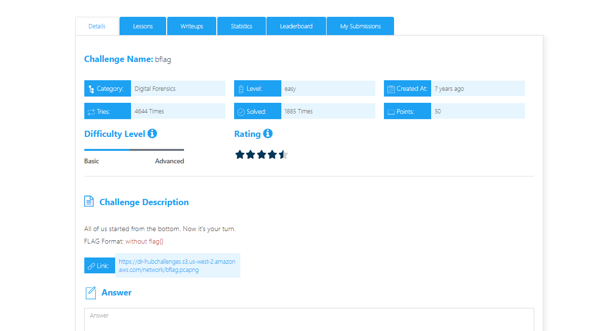
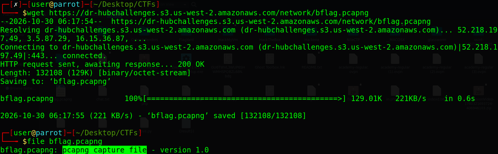
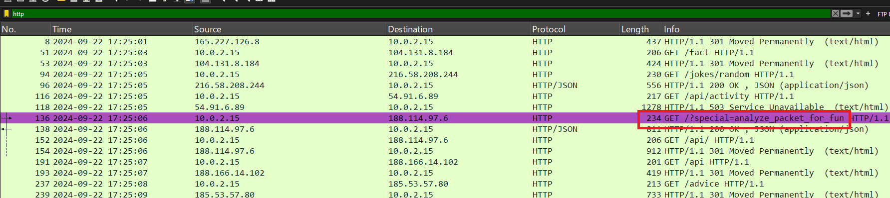
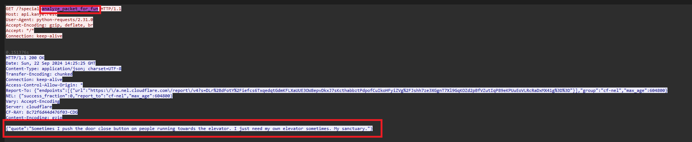

# bflag - Digital Forensics Writeup

## Challenge Description
All of us started from the bottom. Now it’s your turn.



---

## Downloading the PCAP

The challenge provides a PCAP file. It can be downloaded using:

```bash
wget https://dr-hubchallenges.s3.us-west-2.amazonaws.com/network/bflag.pcapng
```

---

## File Analysis

Before opening the capture in Wireshark, I checked the file type to confirm that it was a PCAP file.



---

## Checking for Strings

I also used the `strings` command to check for any readable information inside the capture:

```bash
strings bflag.pcap
```

Nothing useful was found in the output, so the next step was to analyze the traffic using Wireshark.


---

## Analyzing the Traffic

After opening the PCAP in Wireshark, I found an interesting HTTP request with the following path:

```text
/special-analyze_packet_for_fun
```

Following the HTTP stream revealed a JSON response containing the following quote:

```text
Sometimes I push the door close button on people running towards the elevator. I just need my own elevator sometimes. My sanctuary.
```



This information appears to be related to the challenge and can be used to continue the analysis.

## Final Flag

```text
analyze_packet_for_fun
```

