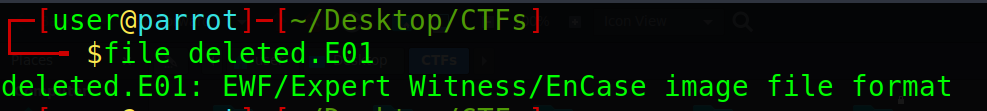
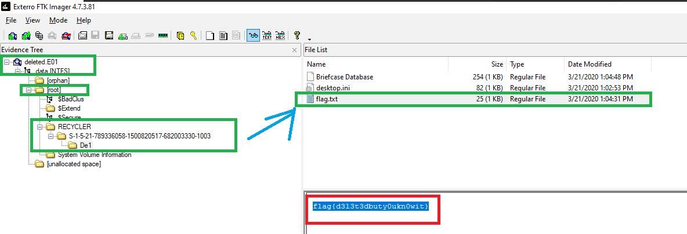

# deleted Challenge Description
hi john i need your assistance to recover my drive


---

## File Analysis

The provided file is an `.E01` forensic image. I used the `file` command to identify its format:

```bash
file deleted.E01
```

The output shows that it is an **EnCase image file format**, a forensic disk image format commonly used to store and analyze digital evidence.



---

## Analyzing the Image

I opened the `.E01` image using **FTK Imager**:

https://www.exterro.com/digital-forensics-software/ftk-imager

After browsing the image contents, a file named `flag.txt` was found in the root directory, containing the flag.



---

## Final Flag

```text
flag{d3l3t3d1y0urDriv3}
```