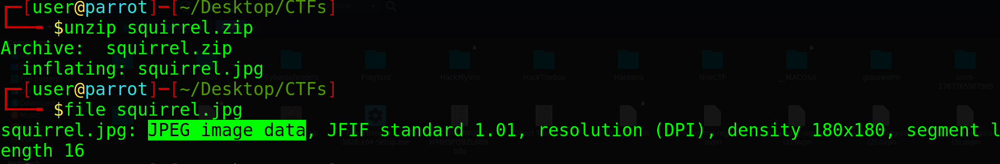
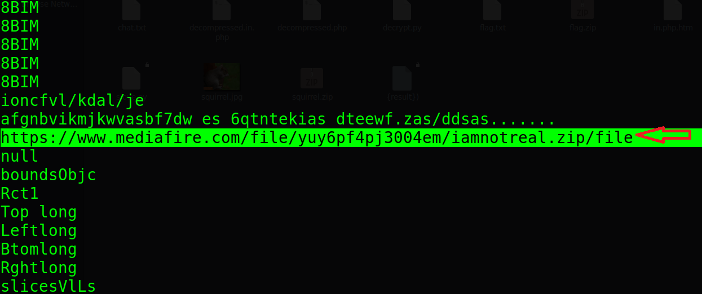
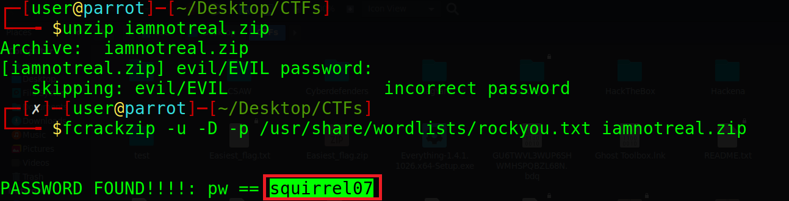
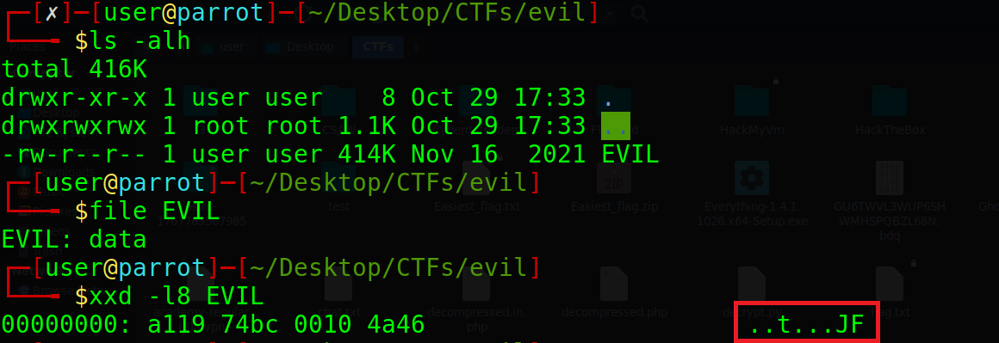
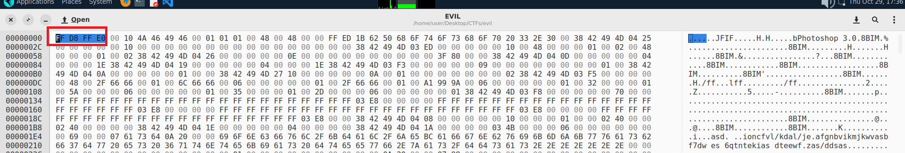
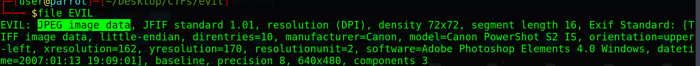
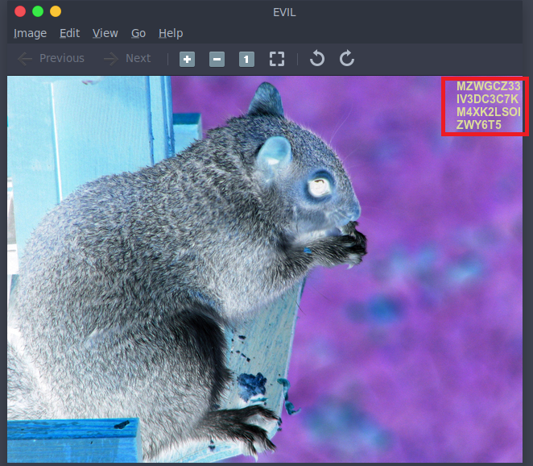
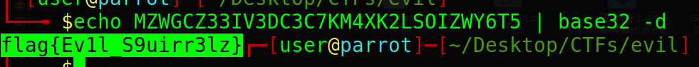

# squirrel - Digital Forensics Writeup

## Challenge Description
an image tells a story, try to discover more details.


---

## Downloading the File

The provided download link contains a ZIP file with the squirrel image. After downloading it, the archive was extracted using:

```bash
unzip squirrel.zip
```



---

## Inspecting the Image

Next, I used the `strings` command to search for readable information inside the image:

```bash
strings squirrel.jpg | less
```

The output contained a MediaFire link pointing to another ZIP file named `iamnotreal.zip`.



---

## Cracking the ZIP Password

The `iamnotreal.zip` file was password-protected, so I used `fcrackzip` with the `rockyou.txt` wordlist:

```bash
fcrackzip -u -D -p /usr/share/wordlists/rockyou.txt iamnotreal.zip
```

The password was found to be:

```text
squirrel07
```



---

## Extracting the Archive

The archive was extracted using the recovered password. This created a new folder named `evil` containing a file called `EVIL`.


---

## Analyzing the File Signature

The `EVIL` file appeared to be a JPEG image, but it could not be opened normally.

I compared its first few bytes with the original `squirrel.jpg` file and noticed that the JPEG file signature was incorrect.



---

## Fixing the JPEG Header

Using a hex editor (ghex), the incorrect header was replaced with the standard JPEG signature:

```text
FF D8 FF E0
```





---

## Recovering the Image

After fixing the file signature, the file could be opened successfully and revealed the hidden image.



---

## Decoding the Hidden Data

The recovered data was encoded using Base32.

It was decoded using:

```bash
echo MZWGCZ33IV3DC3C7KM4XK2LSOIZWY6T5 | base32 -d
```

---

## Final Flag

```text
flag{Ev1l_S9uirr3lz}
```

