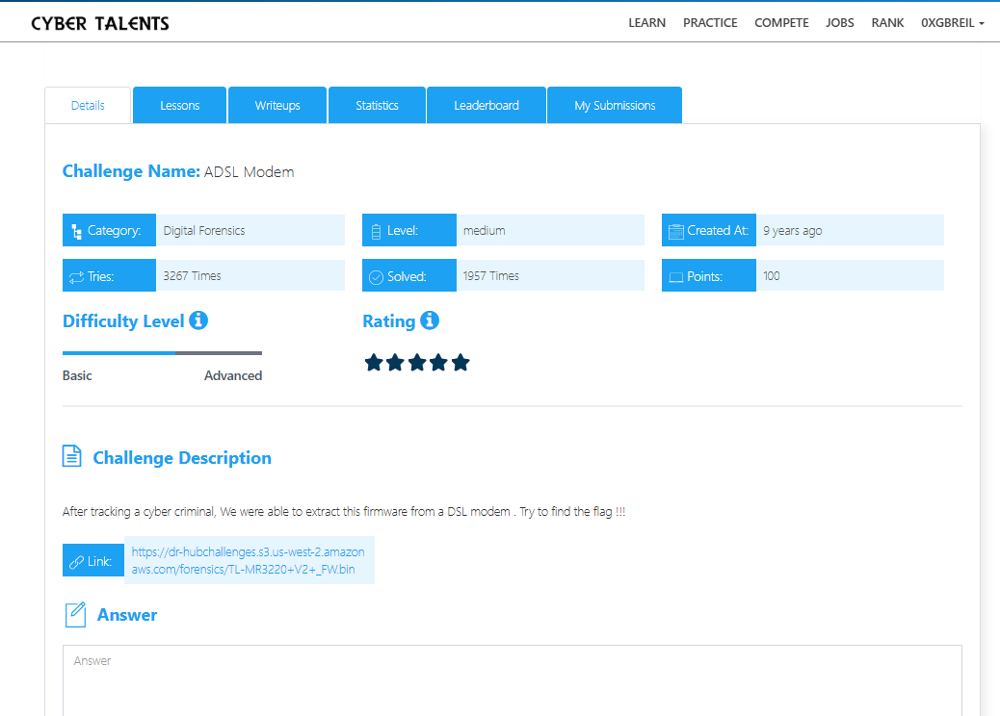

# Cyber Talents CTF Walkthrough: ADSL Modem

## Challenge Description

After tracking a cyber criminal, We were able to extract this firmware from a DSL modem . Try to find the flag !!!



## Solution

### Step 1: Identify the Firmware File

We are provided with a firmware file named `TL-MR3220+V2+_FW.bin`.

First, use the `file` command to identify its actual file format:

```bash
file TL-MR3220+V2+_FW.bin
````

The output shows that the file is actually a **RAR archive**, even though its extension is `.bin`.

### **Step 2: Extract the Archive**

Since the file is a RAR archive, we can use `unrar` to extract its contents:

```
unrar e TL-MR3220+V2+_FW.bin
```

During extraction, the tool displays an **Archive comment** containing the flag.

## **Flag**

```
Flag{reversing_FW_is_interesting_but_this_is_for_fun}
```

